# Vayora mobile UI review

This change restyles the Flutter app while preserving its account, access, approval and UPI rules.

## What changed

- One cinematic dark theme, bundled Poppins, orange primary actions and gold Premium elements.
- Shared cards, thumbnails, avatars, badges, loading placeholders, friendly error states and confirmation dialogs.
- Explore is the initial tab. Visited tabs and their scroll controllers remain mounted.
- Clear Log in / Create account choices with password visibility; no guest-upgrade switch.
- Channel creation keeps a required name, optional description, tags, photo selection/replacement and submit feedback. Channel screens do not say “owner approval required”.
- Post actions and a full-screen video player with seeking, play/pause, time and rotation controls.
- Profile has a collapsing warm header, editable name, member/guest account card, My Channels, policy/support links and account controls.
- Settings contains appearance/accessibility details, policies, support, logout and delete-account actions.
- Premium shows plan-table benefits once, compact selectable rows, correct guest/member/launch labels and one priority banner. Free mode uses its own account card.
- Payment status targets an explicit order, polls the existing service, and displays distinct pending/success/failed/cancelled/reversed messages. History shows own newest-first orders and local times.
- Approved creators can choose a channel and publish a photo post through the existing storage policies.
- Storage allowance presentation, profile, support and policy screens.

## Scope boundaries

`mobile/lib/app_state.dart`, `mobile/lib/upi.dart`, Android native handlers, `supabase/**`, and the admin app are unchanged. The same Auth methods, attribution, entitlement checks, signed media URLs, order creation and payment-result reporting remain authoritative.

Cloud file upload, folders, rename and delete were not implemented in the original storage feature. This UI-only PR shows those controls as unavailable; it does not invent functioning file operations. Permanent release signing is also a separate setup step. The APKs produced here are connected testing APKs.

Pending payments say **Waiting for payment verification**, because the existing implementation verifies orders through its current process. It does not claim to poll a bank directly.

## Visual evidence

The visual workflow renders actual Flutter screens with deterministic fictional fixtures, a simulated native decoder, and no production Supabase requests. Placeholder thumbnails and the player scene are test artwork. Screenshots show representative initial viewports; scrollable content continues below.

All nine requested screens are captured at 360 × 900 and 430 × 900, at text scales 1.0 and 1.6. Component tests additionally cover 2.0 text scale. The previous UI is rendered from base commit `b4031746e4f36df5a7f7fdeee9fc5ef75018641c`. Old payment history is compared with the new payment-detail presentation. Existing baseline layout errors are recorded only as baseline evidence; redesigned captures assert no Flutter layout exceptions.

| Screen | Before | After |
| --- | --- | --- |
| Explore | 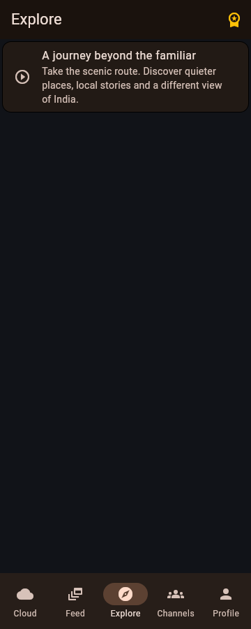 | 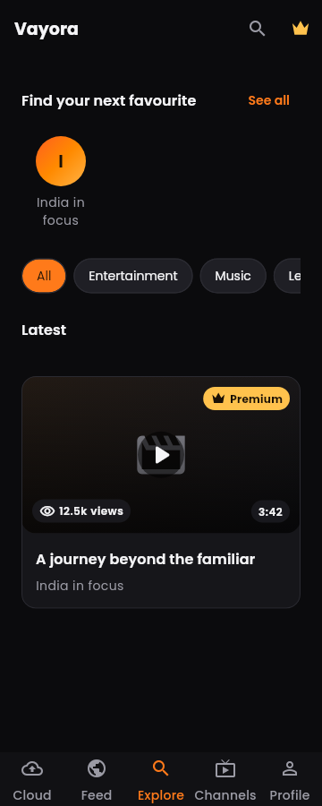 |
| Post |  | 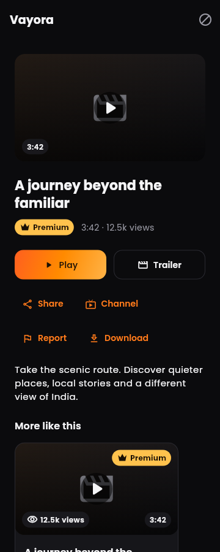 |
| Player | 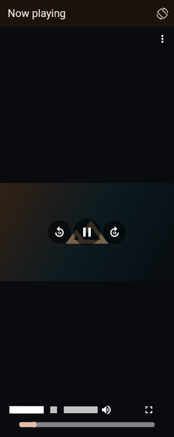 |  |
| Premium | 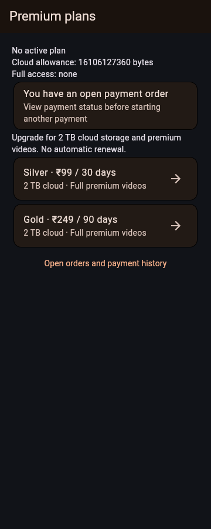 | 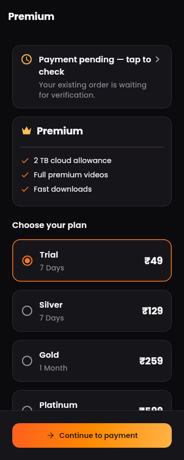 |
| Payment | 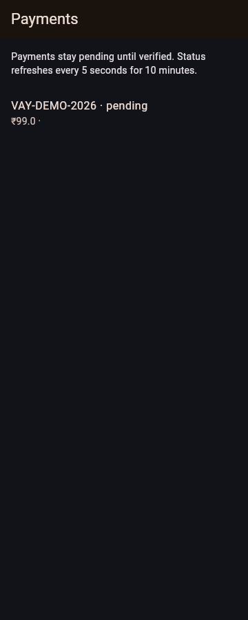 | 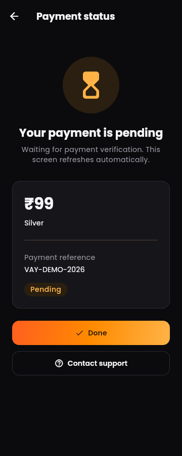 |
| Cloud | 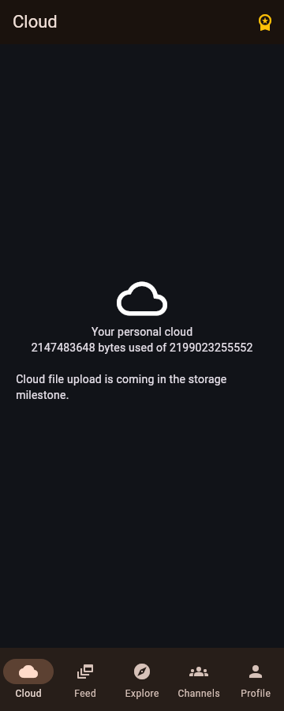 | 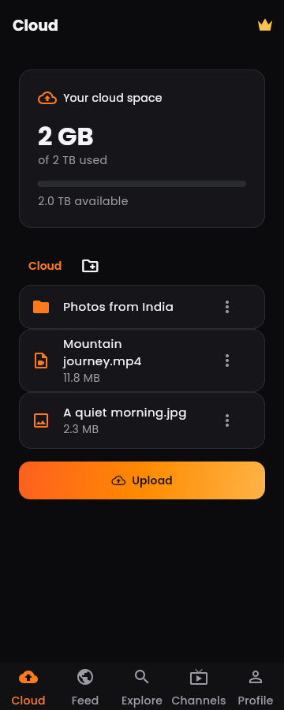 |
| Channels | 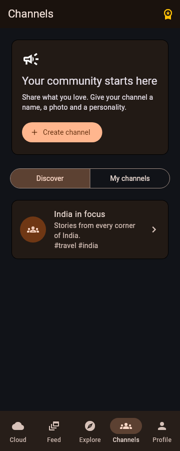 |  |
| Profile | 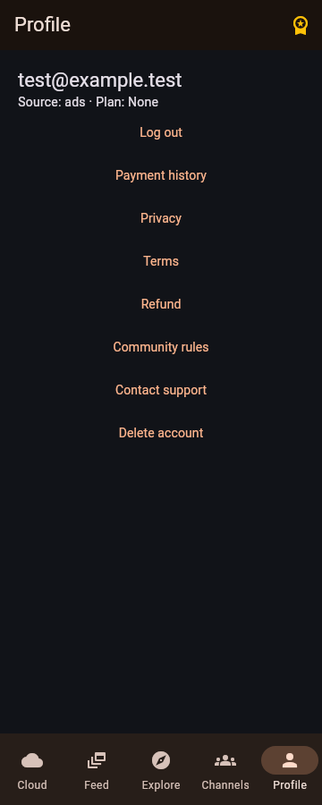 | 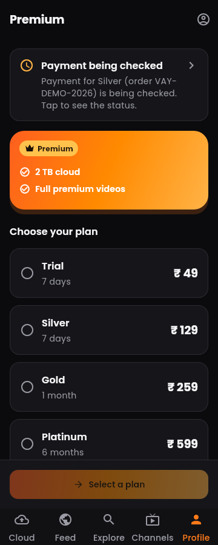 |
| Login |  | 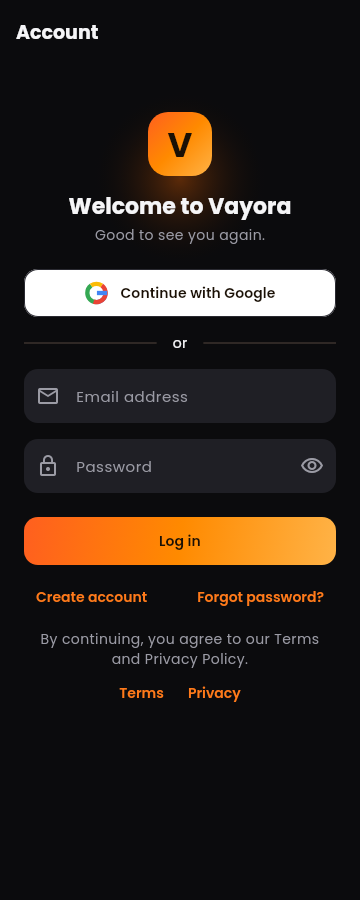 |

## Checks

- Existing account, callback, UPI and channel tests remain in the suite.
- Component tests verify palette/font, gradient and outlined actions, post cards, hidden free-mode crown, and large text.
- The visual job generates then rechecks golden images, and saves review PNGs on the same PR branch.
- The Android job runs `flutter analyze`, `flutter test`, and builds normal and ads testing APKs.

## Account and payment states

The current signup trigger leaves names empty. The UI shows a deterministic User-ID fallback without changing the database trigger. The new post composer supports photos using the existing picker; it does not add video upload.

| State | Screenshot |
| --- | --- |
| Guest Profile | 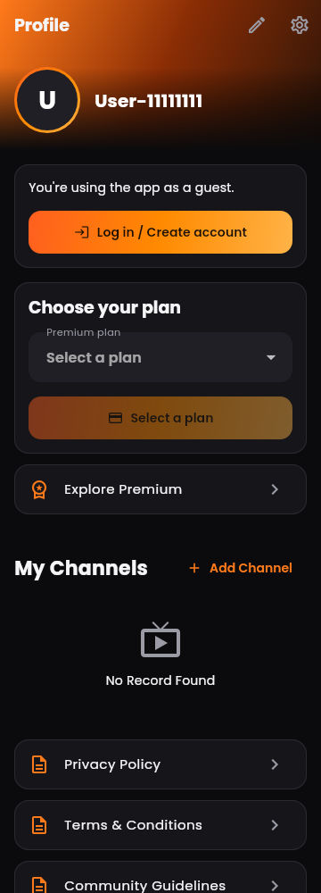 |
| Member Profile | 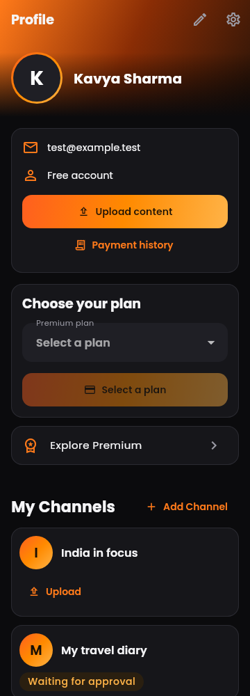 |
| Premium Profile | 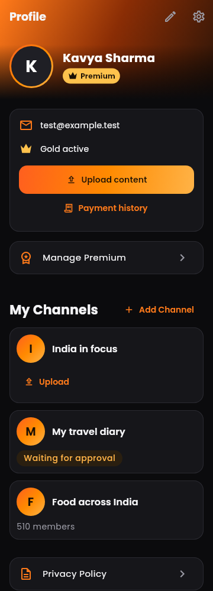 |
| Settings | 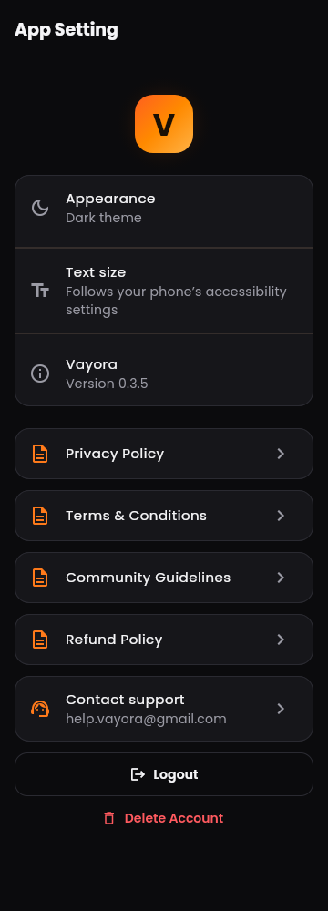 |
| Paid Premium | 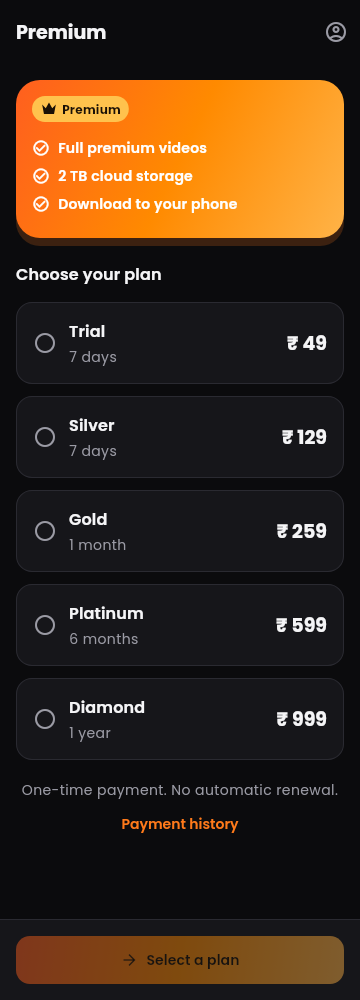 |
| Free-mode Premium |  |
| Payment pending | 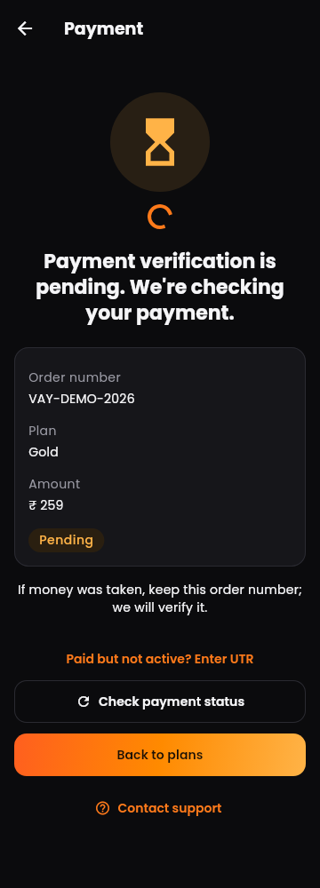 |
| Payment success | 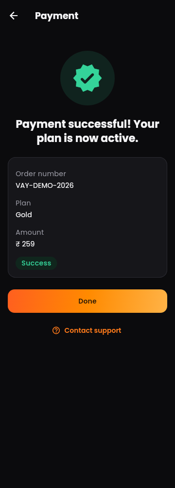 |
| Payment failed | 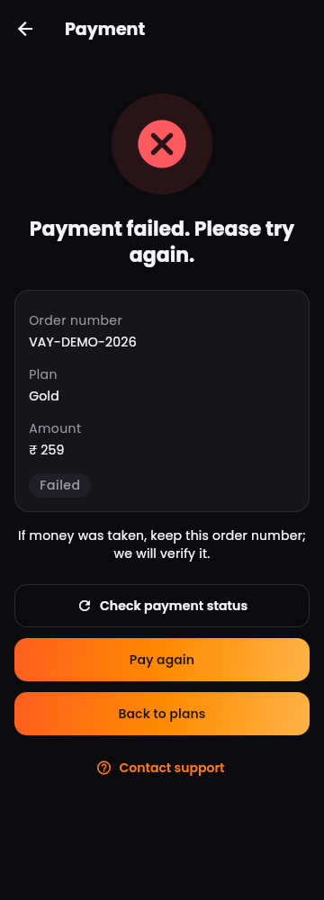 |
| Payment cancelled | 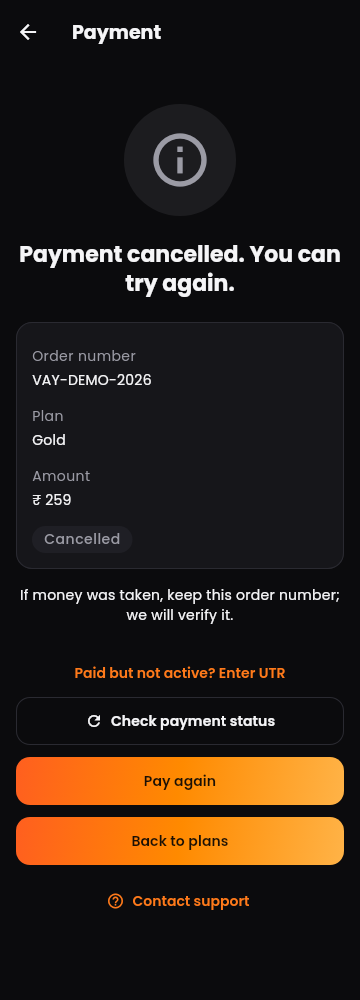 |
| Payment reversed | 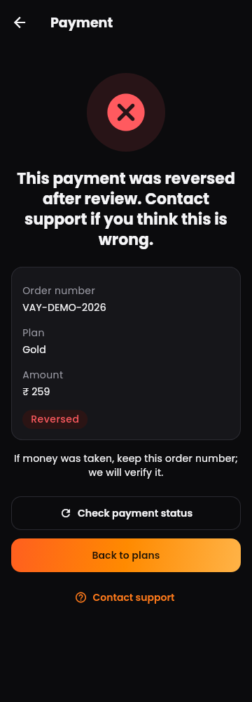 |
| Payment history | 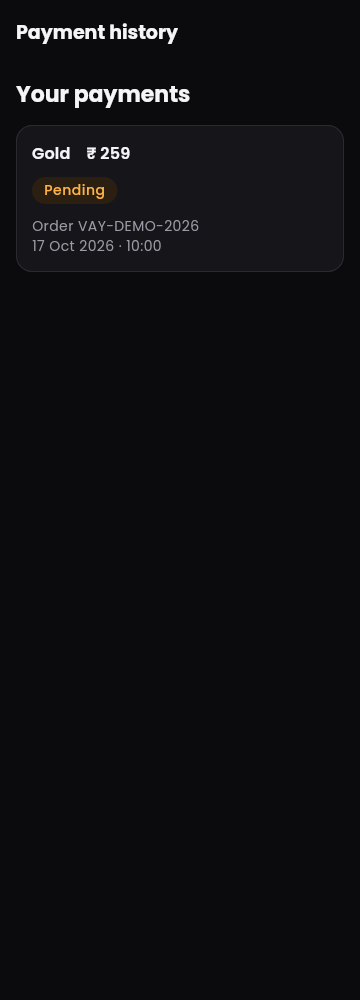 |
